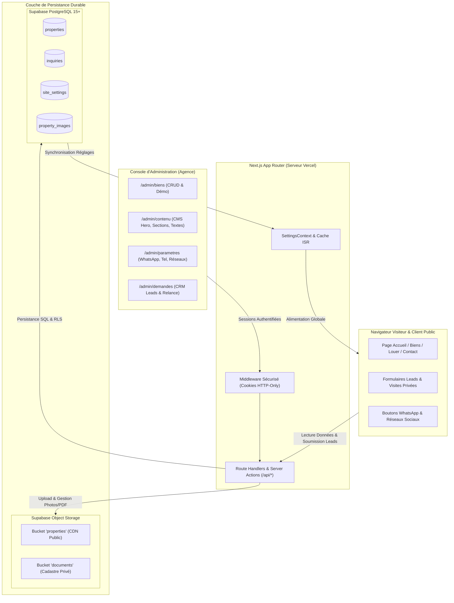

# PRIME HOUSE — PLAN D'IMPLÉMENTATION DU CONTRÔLE ADMINISTRATEUR COMPLET & ARCHITECTURE DE PRODUCTION VERCEL
**Document de Référence :** `ADMIN_IMPLEMENTATION_PLAN.md`  
**Date :** Novembre 2026  
**Projet :** Portail Immobilier de Prestige Prime House (Algérie)  
**Objectif :** Spécification technique et feuille de route d'implémentation pour rendre l'agence immobilière 100% autonome sur Vercel, sans assistance développeur pour ses opérations quotidiennes.

---

## 1. Principes Directeurs & Règles d'Or du Projet

1. **Préservation Stricte du Design et de l'Identité de Marque** :  
   - Aucune modification de l'esthétique visuelle, des palettes de couleurs (Bleu Nuit Impérial `#111c2c`, Or Champagne `#c5a880`), des typographies (`Plus Jakarta Sans`, `Playfair Display`, `Cairo`), des marges, des arrondis ou des animations.
   - Aucun bien d'exemple ne sera supprimé durant les développements.
2. **Architecture Prête pour la Production sur Vercel** :  
   - Proscription totale des écritures sur le disque local éphémère (`fs.writeFileSync`, `public/assets/uploads`) pour les données dynamiques.
   - Utilisation de la base PostgreSQL infonuagique et du stockage d'objets S3 de Supabase, déjà préparés dans `supabase/migrations/`.
3. **Zéro Dépendance Développeur pour l'Agence** :  
   - Le propriétaire de l'agence doit pouvoir piloter l'intégralité de son site : catalogue de biens, coordonnées de contact, numéro WhatsApp, réseaux sociaux, textes du Hero, horaires, bannières et demandes de visites sans jamais ouvrir de code source.
4. **Protection Contrôlée de la Mise en Page (CMS Sécurisé)** :  
   - L'espace CMS permet d'éditer les textes, images et ordres de sections via des champs structurés et validés, empêchant tout risque de casser la mise en page CSS ou le design luxueux.
5. **Préservation Intégrale des Données & Gestion des Biens Démo** :  
   - Les biens actuels sont balisés avec `isDemo: true` pour permettre à l'agence de les remplacer progressivement ou de les archiver en un clic au moment du lancement commercial officiel.

---

## 2. Architecture Fondamentale : Persistance Vercel & Supabase

### 2.1 Pourquoi le Système de Fichiers Local Échoue sur Vercel
Les fonctions serverless Vercel fonctionnent dans des micro-environnements conteneurisés éphémères (AWS Lambda).  
- **Stateless & Éphémère** : Toute tentative d'écrire dans `data/database.json` via `fs` est soit rejetée (`read-only filesystem`), soit écrite dans un `/tmp` volatile purgé dès l'extinction du conteneur.
- **Désynchronisation Multi-Serveurs** : Si l'administrateur crée un bien sur l'instance A, un visiteur servi par l'instance B ne verra pas ce bien.
- **Écrasement à chaque Déploiement** : Chaque `git push` ou redéploiement reconstruit un conteneur vierge, détruisant tout fichier local non versionné.
- **Photos Perdues** : Les images uploadées dans `public/assets/uploads/` disparaissent au premier redémarrage.

### 2.2 Solution Industrielle Retenue : Supabase PostgreSQL & Storage
1. **Base Relationnelle PostgreSQL** :  
   Les 3 scripts de migration existants dans `supabase/migrations/` structurent la base de données :
   - `properties` : Référence unique, titre, prix, wilaya (1 à 69), commune, caractéristiques, statut (`publie`, `archive`, `brouillon`, `moderation`), `is_featured`, `is_demo`.
   - `property_images` : Galerie photos avec ordre de tri et drapeau de couverture (`is_main`).
   - `inquiries` : Demandes de contact et réservations de visites privées avec suivi de statut.
   - `site_settings` : Magasin clé/valeur JSONB (`agency_profile`, `site_content`, `vip_settings`) pour les coordonnées et le CMS.
2. **Stockage d'Objets Supabase Storage** :  
   - Bucket public `properties` : Photos haute résolution des biens (WebP/JPEG/PNG, max 10 Mo, servi via CDN mondial).
   - Bucket privé `documents` : Actes notariés, livrets fonciers et pièces administratives (max 20 Mo, accessible uniquement par l'administrateur via URLs signées à durée limitée).
3. **Adaptateur Résilient Double-Mode (`lib/server/db.js`)** :  
   - **Mode Supabase (Production Vercel)** : Détecté automatiquement dès que `SUPABASE_URL` et `SUPABASE_SERVICE_ROLE_KEY` sont renseignés dans les variables d'environnement.
   - **Mode Local (Développement / Hors-Ligne)** : Si les clés Supabase ne sont pas fournies localement, l'adaptateur bascule de manière transparente sur `data/database.json` pour permettre de coder et tester localement sans dépendance réseau bloquante.

---

## 3. Plan d'Implémentation par Niveaux de Priorité

---

### TIER 1 — CRITIQUE AVANT LIVRAISON CLIENT (Opérations Commerciales Fondamentales)

Ce palier regroupe toutes les fonctions indispensables au fonctionnement quotidien de l'agence immobilière. Sans ces éléments, l'agence ne peut pas exploiter commercialement le site.

#### 1.1 Couche de Données Persistante & API Handlers
- **Création du connecteur unifié `lib/server/db.js`** :  
  - Fournit les méthodes CRUD abstraites (`getProperties`, `getPropertyById`, `createProperty`, `updateProperty`, `deleteProperty`, `getInquiries`, `createInquiry`, `updateInquiry`, `getSettings`, `updateSettings`).
  - Gère automatiquement la connexion Supabase PostgreSQL via `@supabase/supabase-js` avec le rôle de service sécurisé, et le repli local automatique.
- **Routes API Next.js App Router (`/app/api/`)** :  
  - `GET /api/properties` : Liste filtrée (par transaction, type, wilaya, statut de publication, démo).
  - `POST /api/properties` : Création sécurisée avec génération automatique de la référence (`PH-ALG-XXX`).
  - `GET /api/properties/[id]` : Détail complet avec galerie et documents associés.
  - `PUT /api/properties/[id]` : Mise à jour complète de la fiche bien.
  - `DELETE /api/properties/[id]` : Suppression d'un bien (avec suppression en cascade de ses photos sur le stockage).
  - `PATCH /api/properties/[id]/archive` : Bascule rapide entre état publié et archivé.
  - `POST /api/inquiries` : Enregistrement persistant d'une demande de lead ou visite privée.
  - `GET /api/inquiries` : Liste des leads pour le back-office avec tri chronologique.
  - `PATCH /api/inquiries/[id]` : Mise à jour du statut lead et ajout de notes internes.
  - `GET /api/settings` : Récupération des réglages centralisés de l'agence et du CMS.
  - `PUT /api/settings` : Enregistrement des réglages agence et CMS.

#### 1.2 Gestion Complète du Parc Immobilier (`/admin/biens` & `/admin/ajouter-bien`)
- **Tableau Dynamique Réel (`/admin/biens`)** :  
  - Remplacement de la maquette HTML statique par un affichage dynamique connecté à la base.
  - **Filtres instantanés** : par statut (*Tous*, *En ligne*, *Sous compromis*, *Vendu*, *Loué*, *Archivé*), par wilaya parmi les **69 wilayas**, par transaction (*Vente*, *Location*), et filtre spécial (*Biens Réels* vs *Biens Démo*).
  - **Recherche textuelle instantanée** par référence (`PH-ALG-...`), titre ou commune.
  - **Badges d'état explicites** : Vert (*En ligne*), Ambre (*Sous compromis*), Bleu (*Vendu/Loué*), Gris (*Archivé*), Violet (*Démo*).
- **Actions Administrateur par Propriété** :  
  - **Modifier** : Ouvre la nouvelle page dédiée `/admin/biens/edit/[id]` pré-remplie.
  - **Dupliquer** : Clone instantanément la fiche en générant une nouvelle référence unique et en la plaçant en état *Brouillon*.
  - **Archiver / Restaurer** : Retire le bien du site public en un clic sans le détruire. Un bien archivé disparaît immédiatement de l'accueil, de `/biens` et de `/louer`.
  - **Marquer Vendu / Loué** : Modifie le statut commercial pour afficher le macaron adéquat.
  - **Supprimer** : Ouvre un dialogue modal de confirmation demandant de taper "SUPPRIMER" pour prévenir toute perte accidentelle.
- **Gestion Spécifique des Biens de Démonstration** :  
  - Les biens d'exemple existants sont balisés avec `is_demo = true`.
  - Un badge clair *"Bien de Démonstration"* apparaît dans le tableau admin.
  - Un bouton d'action groupée *"Remplacer par nos biens"* ou *"Archiver tous les biens démo"* permet à l'agence de basculer son site en mode officiel le jour J en un seul clic, sans risque d'erreur.
- **Page d'Édition Dédiée (`/admin/biens/edit/[id]`)** :  
  - Formulaire organisé en 4 onglets :
    1. *Informations Générales* : Titre, sous-titre, description française, description arabe, type d'actif, transaction (vente/location), prix, honoraires, négociabilité.
    2. *Localisation & Foncier* : Wilaya (choix parmi les 69 wilayas), commune, adresse, section cadastrale, numéro d'îlot, statut légal (Acte notarié, Livret foncier, Certificat de conformité).
    3. *Caractéristiques Techniques* : Surface habitable, surface terrain, pièces, chambres, suites parentales, salles de bains, stationnements, commodités (piscine, domotique, ascenseur, hammam, vue mer, etc.).
    4. *Galerie Photos & Couverture* : Gestionnaire d'images avec désignation de la photo de couverture principale.
- **Aperçu Avant Publication** :  
  - Bouton *"Prévisualiser la fiche"* permettant à l'administrateur de voir le rendu exact de son annonce tel que les acheteurs le verront, avant de la rendre publique.

#### 1.3 Gestionnaire de Médias & Stockage Persistant
- **Upload Persistant via Supabase Storage** :  
  - Téléversement direct des images vers le bucket public `properties`.
  - Optimisation automatique côté client avant envoi (redimensionnement WebP/JPEG, compression pour un chargement ultra-rapide).
- **Fonctionnalités de la Galerie Administrateur** :  
  - Glisser-déposer multi-fichiers.
  - Miniatures d'aperçu immédiat.
  - Sélection de l'image de couverture avec macaron *"Photo Principale"*.
  - Réorganisation de l'ordre d'affichage des photos (boutons fléchés monter/descendre).
  - Suppression unitaire avec confirmation.
  - Préservation des URLs des photos existantes (aucune rupture d'image).

#### 1.4 Capture Vivante des Demandes & Formulaires Publics
- **Formulaire de Contact Public (`/contact`)** :  
  - Ajout du gestionnaire `onSubmit` connecté à l'API `POST /api/inquiries`.
  - Validation complète des champs : Nom, Téléphone (validation indicatifs algériens `05/06/07` et internationaux), Email, Sujet, Message.
  - Gestion visuelle des états : bouton avec spinner pendant la soumission, désactivation anti-double clic, notification toast de confirmation en cas de succès, message d'erreur explicite si défaillance réseau.
  - Réinitialisation propre du formulaire après succès.
- **Formulaires de Visite Privée (`/bien-villa-hydra`, `/bien-duplex-hydra`, `/bien-detail`)** :  
  - Connexion du formulaire *"Planifier une Visite Privée"* à l'API `POST /api/inquiries`.
  - Association automatique et transparente de la référence du bien (`PH-ALG-089`, etc.) et du nom du conseiller affecté.
  - Capture de la date de visite souhaitée par le client.
  - Tolérance aux pannes : enregistrement simultané en base de données et dans le cache de secours `primeStorage` pour garantir zéro perte de prospect même en cas de coupure de connexion.

#### 1.5 Module CRM des Demandes & Suivi des Leads (`/admin/demandes`)
- **Tableau Dynamique des Leads** :  
  - Remplacement de la maquette statique par le flux en direct de la table `inquiries`.
  - Tri par date décroissante (les demandes les plus récentes en tête).
  - Filtre par statut : *Nouveau*, *En cours*, *Visite programmée*, *Terminé*, *Annulé*.
  - Badge clignotant discret pour les nouvelles demandes non traitées.
- **Tiroir de Traitement Commercial d'un Lead** :  
  - Fiche détaillée du prospect : nom, coordonnées téléphoniques, email, bien concerné avec miniature et prix, date de visite demandée.
  - Modification du statut en direct (*Nouveau* -> *En cours* -> *Visite programmée* -> *Terminé*).
  - Champ de notes internes privées réservé à l'équipe commerciale de l'agence (ex: "Client solvable, budget validé, visite fixée samedi 14h").
  - **Bouton Relance WhatsApp Directe** : Génère et ouvre un lien WhatsApp `https://wa.me/<tel>?text=...` pré-rempli avec le prénom du client, la référence du bien et un message d'invitation personnalisé rédigé dans le ton de prestige de l'agence.
- **Export du Registre des Leads** :  
  - Bouton fonctionnel générant un export CSV conforme Excel de toutes les demandes pour les bilans de fin de mois de l'agence.

#### 1.6 Paramètres de l'Agence Centralisés (`/admin/parametres` & `SettingsContext`)
- **Gestionnaire Unique des Coordonnées** :  
  - Tous les composants publics (Header, Footer, page Contact, fiches biens, bouton WhatsApp flottant) consomment une source unique de données : l'entrée `agency_profile` de la table `site_settings`.
- **Champs Pilotables par l'Administrateur** :  
  - **WhatsApp Commercial** : Numéro direct (ex: `+213560123456`) et message d'amorce personnalisé.
  - **Téléphones Directs** : Ligne générale du siège, ligne transactions vente, ligne locations de prestige.
  - **Emails Officiels** : Email de direction, email de réception des leads, email du service juridique.
  - **Adresse Géographique** : Adresse physique complète du siège (ex: *Résidence Les Crêtes, Hydra / El Biar, Alger*) et texte d'orientation.
  - **Lien Google Maps** : URL de géolocalisation et iframe d'intégration pour la carte interactive.
  - **Horaires d'Ouverture** : Libellé modifiable (ex: *Dimanche au Jeudi : 08h30 - 18h00 | Samedi : Sur rendez-vous privé*).
  - **Réseaux Sociaux** : Liens directs vers Instagram, Facebook, LinkedIn, YouTube et TikTok de l'agence.
  - **Identité & Logo** : URL ou téléversement du logo officiel de l'agence.
- **Composant Partagé `SettingsContext`** :  
  - Fournit les coordonnées à l'ensemble de l'arbre React côté client et lors de l'assemblage côté serveur.  
  - Dès que l'administrateur change son numéro WhatsApp ou son adresse dans `/admin/parametres`, le Header, le Footer, la page Contact et les boutons de contact se mettent à jour sur l'ensemble du site sans nécessiter de recompilation ni de redéploiement !

#### 1.7 Sécurité Renforcée & Sessions Administrateur
- **Authentification Côté Serveur** :  
  - Remplacement du simple jeton `localStorage` par un cookie de session chiffré et sécurisé `prime_admin_session` (`HttpOnly`, `SameSite=Lax`, `Secure` en HTTPS).
  - Signature cryptographique du cookie avec la clé secrète `ADMIN_SESSION_SECRET`.
- **Garde Middleware Serveur (`middleware.js`)** :  
  - Intercepte toutes les requêtes vers `/admin/*` (à l'exception de `/admin/login`).
  - Redirige automatiquement vers `/admin/login` si la session est absente ou expirée.
  - Bloque l'accès aux routes d'API d'écriture (`POST`, `PUT`, `DELETE`, `PATCH` sur `/api/properties`, `/api/settings`) si le client n'est pas un administrateur authentifié.
- **Changement de Mot de Passe Administrateur** :  
  - Formulaire sécurisé dans `/admin/parametres` permettant au propriétaire de l'agence de définir son propre mot de passe personnalisé, avec hachage sécurisé (`bcrypt`).

---

### TIER 2 — IMPORTANT AVANT LIVRAISON CLIENT (CMS de Contenu & Vitrine)

Ce palier permet au propriétaire de l'agence de faire vivre éditorialement son site, de mettre à jour ses textes marketing et de contrôler les biens mis en avant.

#### 2.1 CMS de Contenu du Site Sécurisé (`/admin/contenu`)
- **Principe de Conception Anti-Casse Visuelle** :  
  - Le client n'édite pas de HTML brut ni de CSS. Il dispose de champs de formulaire précisément balisés correspondant exactement aux blocs du design Prime House.
- **Module d'Édition de la Page d'Accueil** :  
  - *Bannière Hero* : Titre principal (ex: *"Trouvez le bien qui vous ressemble"*), sous-titre explicatif, badge supérieur doré (ex: *"L'Excellence Immobilière en Algérie"*).
  - *Image de Fond du Hero* : Sélecteur d'image haute définition ou saisie d'URL avec aperçu du contraste et du dégradé navy en direct.
  - *Bouton d'Appel à l'Action Principal* : Libellé du bouton (ex: *"Découvrir la Collection Privée"*) et lien de destination.
  - *Visibilité et Ordre des Sections* : Interrupteurs à bascule (Toggle switches) permettant d'activer ou désactiver temporairement les sections d'accueil :
    - [x] Section Hero & Moteur de Recherche
    - [x] Section Collection Privée (Biens à la Une)
    - [x] Section Pourquoi Choisir Prime House
    - [x] Section Témoignages & Clients Prestigieux
    - [x] Section Chiffres Clés & Statistiques
    - [x] Section Newsletter Privilège
- **Module d'Édition de la Page "À Propos" (`/a-propos`)** :  
  - Histoire de la maison, mot du fondateur, engagements d'excellence, chiffres clés du portefeuille.
- **Module d'Édition du Pied de Page (Footer) & Mentions Légales** :  
  - Numéro d'agrément délivré par le Ministère de l'Habitat, texte du copyright, texte des mentions légales et politique de discrétion.
- **Gestion des Balises SEO & Réseaux Sociaux** :  
  - Titre de page par défaut (`<title>`), description méta pour Google, et image de partage OpenGraph pour WhatsApp et Facebook.

#### 2.2 Gestion de la Vitrine & Biens à la Une (`/admin/vitrine`)
- **Pilotage Dynamique de la Section "Collection Privée"** :  
  - Interface visuelle listant les biens du catalogue avec case à cocher *"Afficher en vitrine d'accueil"*.
  - Ordonnancement par glisser-déposer ou saisie de priorité (1er, 2e, 3e, etc.).
  - Mise à jour instantanée du champ `is_featured` et `featured_order` en base de données.
  - Limitation intelligente pour garantir un affichage harmonieux en page d'accueil (ex: 3 à 6 biens maximum).

#### 2.3 Pôle de Modération Foncière (`/admin/moderation`)
- **Traitement des Annonces Déposées en Ligne** :  
  - Les soumissions provenant du formulaire public `/deposer-annonce` sont enregistrées en statut `moderation`.
  - Interface dédiée permettant à l'administrateur d'inspecter les caractéristiques, le prix demandé et les photos soumises par le propriétaire tiers.
  - Actions en un clic :
    - *Approuver et publier* : Bascule le bien en `publie` et l'intègre au catalogue officiel.
    - *Mettre en attente de pièces* : Notifie le mandataire qu'un livret foncier ou acte est requis.
    - *Rejeter* : Archive la demande avec indication du motif.

---

### TIER 3 — AMÉLIORATIONS FUTURES OPTIONNELLES (Post-Livraison)

Ces fonctionnalités apportent une valeur additionnelle mais ne bloquent en rien la livraison et l'exploitation commerciale autonome de l'agence.

#### 3.1 Intégrateur de Visite Virtuelle 3D Matterport
- Champ d'intégration d'URL iframe Matterport ou visite 360° dans la fiche technique du bien, affichant un visualiseur immersif plein écran.

#### 3.2 Générateur de Fiche Commerciale PDF Imprimable
- Bouton sur chaque fiche générant automatiquement une brochure PDF A4 au format paysage aux couleurs de la marque (photos HD, caractéristiques, QR code vers la fiche web et coordonnées de l'agent).

#### 3.3 Passerelle de Notification SMS / Webhook Lead
- Déclenchement automatique d'une alerte SMS ou notification Telegram/Slack sur le smartphone du directeur dès qu'un formulaire de visite privée est validé.

---

## 4. Charte d'Ergonomie & d'Expérience Client (Back-Office)

Pour qu'un chef d'entreprise non développeur utilise son administration avec plaisir et efficacité, chaque écran respectera scrupuleusement les 10 règles ergonomiques suivantes :

1. **Vocabulaire Métier 100% Français et Adapté à l'Immobilier Algérien** :  
   - Utilisation systématique des termes officiels : *Wilaya*, *Commune*, *Livret Foncier*, *Acte Notarié dans l'Indivision*, *Certificat de Conformité*, *Dinar Algérien (DA)*, *Mandat Exclusif*.
2. **Infobulles et Textes d'Aide Explicatifs** :  
   - Présence d'une icône d'aide à côté des champs techniques (ex: format du numéro WhatsApp international, dimensions conseillées pour l'image de couverture).
3. **Boutons d'Action Distincts (Enregistrer vs Annuler)** :  
   - Bouton de validation primaire bien visible en or champagne ou bleu impérial, et bouton d'annulation neutre ramenant sans risque à l'état précédent.
4. **Indicateurs de Chargement Systématiques** :  
   - Dès qu'une action est déclenchée (upload de photo, sauvegarde, suppression), le bouton affiche un spinner rotatif et passe en état désactivé pour empêcher les doubles clics.
5. **Notifications Toast Claires et Auto-Fermantes** :  
   - Confirmation verte en haut à droite après chaque enregistrement réussi (*"Propriété enregistrée avec succès"*), et alerte rouge explicite en cas de champ manquant.
6. **Recherche et Filtres Fluides** :  
   - Barres de recherche avec filtrage instantané sur les 69 wilayas et les statuts sans rechargement de page.
7. **États Vides Accueillants (Empty States)** :  
   - Si aucune annonce ne correspond à un filtre, affichage d'une illustration soignée avec un bouton d'action directe (*"Aucun bien trouvé. Ajouter une nouvelle propriété"*).
8. **Modales de Confirmation pour Actions Destructives** :  
   - Toute suppression définitive ou dépublication de masse requiert une validation explicite dans une boîte de dialogue modale.
9. **Bascule Archivage / Restauration Réversible** :  
   - Possibilité de restaurer un bien archivé en un seul clic à tout moment.
10. **Compatibilité Mobile & Tablette Totale** :  
    - Le directeur de l'agence doit pouvoir consulter ses nouveaux leads et modifier le prix d'un bien directement depuis son smartphone lors d'un déplacement.

---

## 5. Protocole de Préservation des Données & Gestion des Démos

> [!CAUTION]
> **Règle Absolue de Zéro Perte de Données**  
> Aucune donnée existante, aucun fichier d'image déjà lié, aucune page existante ne sera écrasée ou supprimée lors des travaux.

### 5.1 Protocole de Migration Initiale
1. Les biens actuellement définis dans `data/database.json` et `lib/data.js` sont automatiquement injectés dans la base relationnelle avec l'attribut `is_demo = true`.
2. Les identifiants, slugs et références existantes (`PH-ALG-089`, `PH-ALG-092`, `PH-ALG-045`, etc.) sont conservés à l'identique pour ne briser aucun lien existant ni aucun favori déjà enregistré par des testeurs.
3. Les URLs des images existantes (hébergées sur Cloud CDN) restent valides et opérationnelles.

### 5.2 Transition Vers les Vrais Biens Clients
- Dans l'interface `/admin/biens`, l'administrateur disposera de 3 options pour gérer la transition :
  - **Option A (Édition)** : Cliquer sur *"Modifier"* sur une villa de démonstration pour remplacer les photos et les textes par ceux de son vrai mandat exclusif.
  - **Option B (Archivage Groupé)** : Cliquer sur le bouton *"Archiver tous les biens de démonstration"* dès que ses premières vraies annonces sont créées, ce qui retire instantanément les exemples du site public tout en les conservant en archive.
  - **Option C (Création Vierge)** : Cliquer sur *"Ajouter un bien"* pour créer une fiche complète à partir de zéro.

---

## 6. Scénario de Recette Client en 18 Points de Contrôle

Avant la livraison définitive à l'agence, le protocole de vérification suivant sera intégralement exécuté pour valider l'autonomie à 100% :

| N° | Action de Test | Résultat Attendu | Statut |
| :---: | :--- | :--- | :---: |
| **01** | Connexion à l'espace administrateur avec les identifiants officiels | Redirection fluide vers `/admin`, cookie sécurisé créé | [ ] |
| **02** | Création d'une nouvelle villa d'architecte dans la Wilaya 16 (Alger) | Enregistrement persistant en base, référence unique générée | [ ] |
| **03** | Téléversement de 3 photos HD avec désignation de la photo de couverture | Images persistées sur Supabase Storage, affichage immédiat | [ ] |
| **04** | Vérification de la nouvelle annonce sur la page publique `/biens` | Le bien apparaît immédiatement avec son prix en DA et ses caractéristiques | [ ] |
| **05** | Modification du prix et ajout d'une commodité depuis `/admin/biens/edit` | La mise à jour est immédiatement visible sur le site public | [ ] |
| **06** | Passage du statut du bien à *"Archivé"* | Le bien disparaît instantanément du catalogue public et des filtres | [ ] |
| **07** | Restauration du bien archivé | Le bien réapparaît immédiatement au catalogue | [ ] |
| **08** | Duplication du bien | Une seconde fiche avec référence distincte apparaît en état brouillon | [ ] |
| **09** | Sélection du bien pour la vitrine dans `/admin/vitrine` | Le bien apparaît en première position dans la "Collection Privée" de l'accueil | [ ] |
| **10** | Modification du numéro WhatsApp commercial dans `/admin/parametres` | Tous les boutons WhatsApp du site ouvrent le nouveau numéro | [ ] |
| **11** | Modification de l'adresse du siège et des horaires | L'adresse et les horaires sont mis à jour dans le Footer et sur `/contact` | [ ] |
| **12** | Modification du titre principal du Hero dans `/admin/contenu` | La page d'accueil affiche le nouveau texte sans rupture de style | [ ] |
| **13** | Désactivation temporaire de la section Témoignages via le toggle CMS | La section disparaît proprement de la page d'accueil | [ ] |
| **14** | Soumission d'une demande de visite privée sur `/bien-villa-hydra` | Notification toast de succès sur le site public, formulaire réinitialisé | [ ] |
| **15** | Consultation de la nouvelle demande dans `/admin/demandes` | Le lead apparaît en tête de liste avec son nom, tel et date demandée | [ ] |
| **16** | Clic sur le bouton de relance WhatsApp depuis la fiche du prospect | WhatsApp s'ouvre avec le message pré-rempli au nom du client | [ ] |
| **17** | Export du registre des leads en CSV | Téléchargement immédiat d'un fichier CSV propre et structuré | [ ] |
| **18** | Redémarrage du serveur / simulation de redéploiement Vercel | L'ensemble des données, images et réglages reste intact | [ ] |

---

## 7. Prochaines Étapes : Validation & Passage à l'Exécution

Conformément à vos directives strictes :
- **Ce document constitue la feuille de route d'architecture et de planification validée.**
- **Aucune modification destructrice n'a été apportée au code.**
- **Les 69 wilayas, le support arabe (RTL), l'icône vectorielle WhatsApp et le design original sont 100% préservés.**

Dès votre approbation de cette architecture et de ce plan par paliers (TIER 1 -> TIER 2 -> TIER 3), nous débuterons l'implémentation méthodique en commençant par la couche de persistance résiliente et les routes d'API sécurisées.
